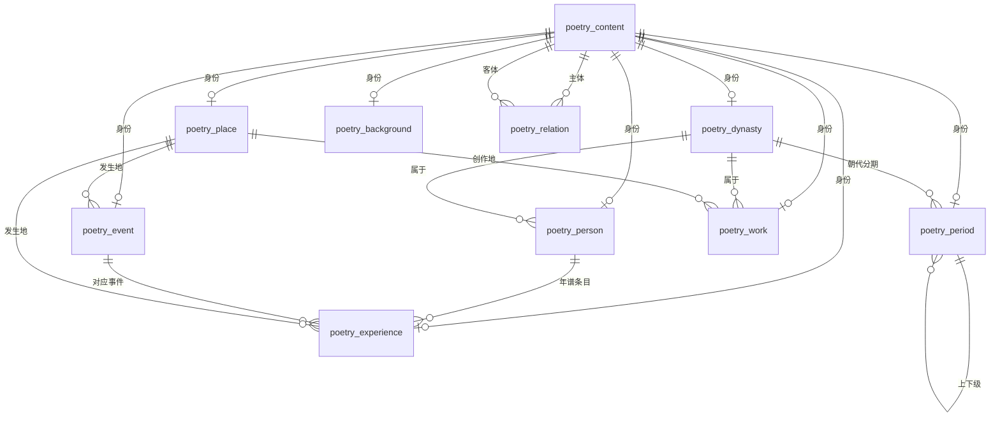
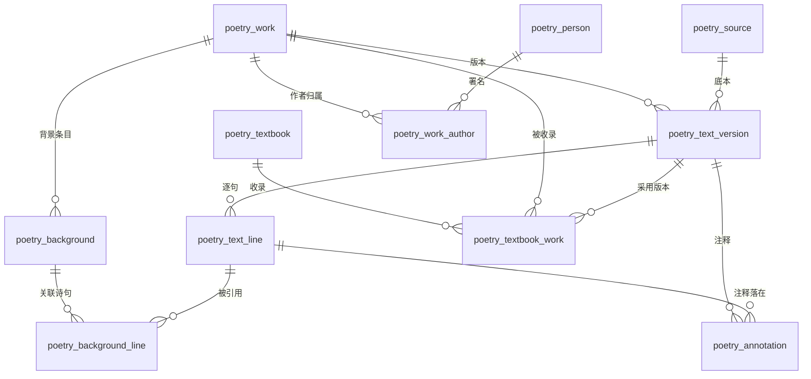
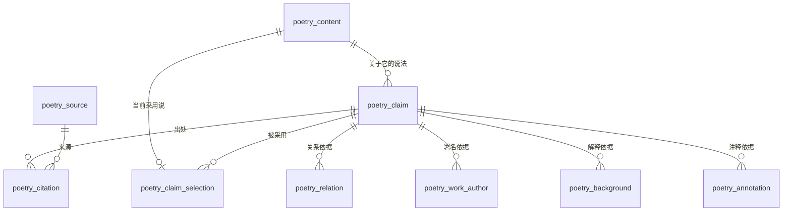
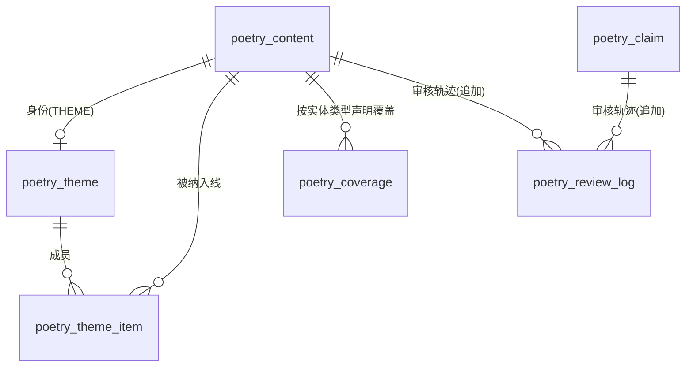
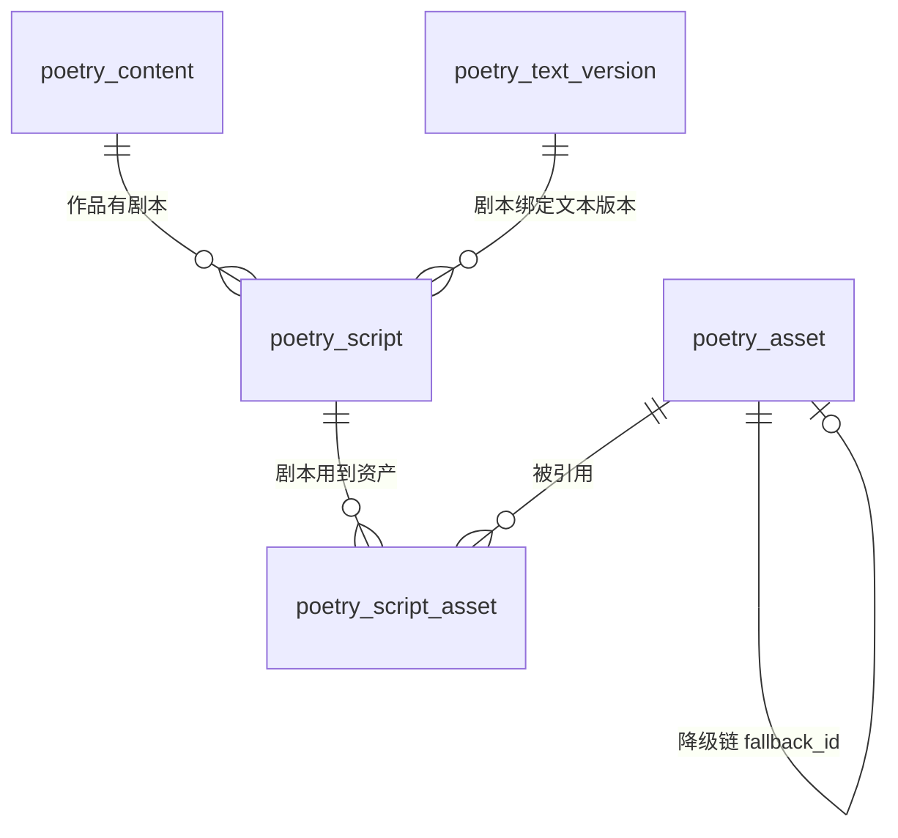

# 内容底座数据模型

状态：**已在真实 MySQL 5.6.40 上落地**（库 `vpn`，与宿主应用同库，靠 `poetry_` 前缀隔离）。
迁移脚本：`V001__foundation.sql`（22 表，2026-11-06 00:33 已应用）→ `V003__integrity.sql`（加固 +4 表，2026-11-06 14:14 已应用）→ `V002__draft_seed.sql` → `V004__chunwang_context_draft.sql`（《春望》草稿闭环）→ `V006__media_and_script.sql`（+3 表：`poetry_asset` / `poetry_script` / `poetry_script_asset`，2026-11-06 15:44 已应用），**均已执行**；126 项核查真库全 0（15:45 实测）。
全部 `poetry_` 前缀，**无外键**；回退只有 `drop_poetry_objects.sql`（会清空所有 poetry 表）。
现场事实：服务端默认字符集是 `utf8`，我们的表显式声明 `utf8mb4`（中文实测正常）；该账号**没有建库权限**，所以只能同库前缀隔离，不能另起 `*_dev` 库。

## 1. 模型主旨（为什么是这个形状）

产品要同时成立两件事：**看见历史全貌** 与 **读懂一首诗**。因此模型必须做到：

1. **统一内容身份**：朝代、人物、事件、作品等都能出现在同一条时间轴上 → `poetry_content` 承载身份、时间、发布状态；实体细节在各自的子表。
2. **说法与出处分离**：一个事实可以有多派说法并存（`poetry_claim`），采用哪一说单独记录（`poetry_claim_selection`）。
3. **背景必须落到具体诗句**：`poetry_background_line` 把背景钉到某版本文的具体句子上，防止"背景吞掉文本"。
4. **文本版本与教材位置分离**：诗的版本（简体/繁体/异文）与"哪本教材哪一课用哪个版本"是两件事。
5. **事实 / 解释 / 演绎显式区分**：`claim_kind = FACT / INTERPRETATION / DRAMATIZATION`，演绎必须 `dramatization_labeled=1`。

## 2. 实体关系

### 2.1 内容主干



### 2.2 文本与背景



### 2.3 证据链（底座的可信度来自这里）



### 2.4 主题线 / 覆盖 / 审核轨迹（V003 新增）



`poetry_review_log` 只追加、`poetry_coverage` 是声明而非统计，两者都**不参与**读侧发布闸门；它们服务的是审核与"空白意味着什么"。

## 2.4 媒体与剧本层（V006，2026-11-06 已落地）



| 表 | 作用 | 关键约束（代码/核查层，无外键） |
|---|---|---|
| `poetry_asset` | 可复用媒体资产：插画/地图/角色/音频/音色/字幕/视频 | `hash` 唯一（内容寻址）；`meaning NOT NULL`（说不出"帮学生懂哪一句"就不许存在，= 编译规则 R10）；`fallback_id` 必须指向更低 level，L0 行才允许为空（R4）；`rights_origin/rights_license NOT NULL`（R10） |
| `poetry_script` | 剧本版本（作者手写的"这首诗怎么讲"），编译产物 hash 在此登记 | `(id, script_version)` 主键；`bundle_hash` 唯一；`coverage_notice NOT NULL`（R5）；`status=PUBLISHED` 时 `bundle_hash` 必须非空、文本版本必须已发布（C8） |
| `poetry_script_asset` | 剧本版本 ↔ 资产 ↔ 五步 的使用关系 | 用来回答"这个音色还能不能下线""重做这首诗要多少钱"；`step` 限定五步 |

**为什么这三张表现在建，而不是等 P4/P5**：编译规则（降级链闭合、hash 一致、rights 齐全、资产必须解释某句诗）只有在数据层有落点时才可能成为核查项；否则它们只是文档里的句子。C8 的 20 项核查就是这些规则的替身。

## 3. 表清单

| 表 | 是什么 | 关键点 | 当前数据 |
|---|---|---|---|
| `poetry_content` | 所有内容实体的统一身份 | 时间范围、发布状态、审核人、revision | 3 条草稿 |
| `poetry_dynasty` / `poetry_period` | 朝代 / 朝代内分期 | 分期可多级 | 1 条草稿（唐） |
| `poetry_place` | 地点 | 今名 + 经纬度 + 坐标系，可空（不假装有坐标） | 无 |
| `poetry_person` | 人物 | 朝代、字 | 1 条草稿（杜甫） |
| `poetry_event` | 历史事件 | 发生地 | 无 |
| `poetry_experience` | 人物年谱条目 | 挂人 / 事件 / 地点 | 无 |
| `poetry_work` | 作品 | 朝代、创作地、体裁 | 1 条草稿（春望） |
| `poetry_work_author` | 作品-作者归属 | `attribution` PENDING/ACCEPTED/DISPUTED/REJECTED | 1 条待核查 |
| `poetry_text_version` | 文本版本 | 必须有底本来源；简体/繁体 | 1 条草稿 |
| `poetry_text_line` | 逐句 | (version_id, line_seq) 主键 | 8 句草稿 |
| `poetry_background` | 背景条目 | 四层处境；必须关联具体句 | 无 |
| `poetry_background_line` | 背景↔诗句 | 可跨多句；版本必须同作品 | 无 |
| `poetry_annotation` | 教材式注释 | 注释类型 + 学段 | 无 |
| `poetry_relation` | 任意两实体关系 | 边必须带依据 claim | 无 |
| `poetry_source` | 来源 | 独立核查状态 | 1 条待核查 |
| `poetry_claim` | 说法 | FACT/INTERPRETATION/DRAMATIZATION + 确定性 | 1 条待核查 |
| `poetry_citation` | 说法↔来源 | locator 必填非空 | 1 条 |
| `poetry_claim_selection` | 当前采用说 | 同主体同属性只有一个采用 | 无 |
| `poetry_textbook` | 教材 | 学段/年级/册次/版次/ISBN | 无 |
| `poetry_textbook_work` | 教材收录作品 | 必须给页码定位 + 采用版本 | 无 |
| `poetry_theme` / `poetry_theme_item` | 主题线 + 成员（V003） | 成员有 ordinal 与角色 ANCHOR/MEMBER/CONTEXT；发布需 ≥2 个已发布成员 | 1 条草稿线（安史之乱）+ 4 成员 |
| `poetry_coverage` | 覆盖声明（V003） | 时间轴返回它，而不是 Java 里写死一句话 | 3 条（PARTIAL×2、PLANNED×1） |
| `poetry_review_log` | 审核历史（V003） | **追加式**，永不 UPDATE/DELETE | 7 条 |
| `poetry_schema_version` | 脚本版本记录 | 手工 INSERT，无自动迁移器 | 4 条 |

V003 同时给既有表加了列：`poetry_background.body_text`（取代 `primary_text/middle_text`）与 `audience`；`poetry_source.source_kind/reliability`；`poetry_place.parent_id`（古今层级，结构已就位、数据待录）。

## 4. 枚举词表（无 DB 约束，核查 SQL 的 C7 项负责发现越界）

| 字段 | 允许值 | 含义 |
|---|---|---|
| `poetry_content.entity_type` | DYNASTY, PERIOD, PLACE, PERSON, EVENT, EXPERIENCE, WORK, BACKGROUND, THEME | 与接口 `type` 参数一致；Java 侧唯一定义在 `domain/Vocabulary.java` |
| `status`（content/claim/text_version） | DRAFT, IN_REVIEW, PUBLISHED, RETRACTED | 只有 PUBLISHED 且审核齐全才可见 |
| `time_precision` | UNKNOWN, EXACT, RANGE, APPROXIMATE | 见第 6 节 |
| `claim_kind` | FACT, INTERPRETATION, DRAMATIZATION | 演绎必须打标 |
| `certainty` | KNOWN, LIKELY, DISPUTED, UNKNOWN | 说法自身的确定程度 |
| `verification_status`（source） | PENDING, VERIFIED, REJECTED | 只有 VERIFIED 且审核齐全才能支撑发布 |
| `script` | SIMPLIFIED, TRADITIONAL | 文本版本字形 |
| `attribution` | PENDING, ACCEPTED, DISPUTED, REJECTED | 读侧只输出 ACCEPTED / DISPUTED |
| `audience` | PRIMARY, JUNIOR, SENIOR | 学段（annotation 必填；background 发布时必填） |
| `layer` | SCENE, CITY, WORLD, PERSON | 四层处境：眼前 / 这座城 / 这个天下 / 这个人 |
| `annotation_kind` | WORD, PHRASE, ALLUSION, IMAGE, RHYME, OTHER | 意象与音韵先用注释承载，不另立表 |
| `source_kind` | OFFICIAL_HISTORY, YEAR_BOOK, ANTHOLOGY, TEXTBOOK, MODERN_STUDY, DIGITIZED_TEXT, ONLINE_ENTRY, OTHER | 审核分级用；可空，但空就不能 VERIFIED |
| `reliability` | HIGH, MEDIUM, LOW, UNKNOWN | 编者分级判断，不等于已核查 |
| `coverage_kind` | FULL, PARTIAL, PLANNED | FULL 只在真的录全时才允许 |
| `item_role`（theme_item） | ANCHOR, MEMBER, CONTEXT | 一条线需要一个锚点 |
| `decision`（review_log） | SUBMITTED, CHANGES_REQUESTED, APPROVED, REJECTED, PUBLISHED, RETRACTED, REOPENED | 追加式审核轨迹 |

词表有**三处**表达：`Vocabulary.java`、`audit_integrity_checks.sql`（C7 项）、本页。启动自检会读 classpath 上的核查 SQL 比对词表，漂移会打 WARN。

## 5. 无外键之后的九条约定（这就是新的"约束"）

数据库不允许设置外键，代码也不写外键配置。完整性由**三层**承担：读侧 JOIN 闸门、录入顺序约定、核查 SQL。

1. **录入顺序**：`poetry_content` → 实体子表 → claim → source/citation/selection → 明细关联表。
   **BACKGROUND 例外**：content → claim → `poetry_background` → citation → background_line（两者互相引用，先建 claim）。
2. **永不 `DELETE`**：撤回用 `status='RETRACTED'`。删父行会留下读不到但会累积的孤儿。
3. **写年代 = 两件事**：`content.start_year/end_year/time_precision`（展示值）**加** `property_key='time.span'` 的 FACT claim 加采用说。少一步，`C6_published_timed_content_without_adopted_time_claim` 报警。
4. **背景与版本必须同作品**：`poetry_background_line.version_id` 必须属于该背景所属作品（`C4_background_line_cross_work` 能抓出跨作品泄漏）。
5. **依据必须自洽**：relation / annotation / work_author / background 引用的 claim，其 `subject_id` 必须就是本体（work_author 还要求 `property_key='authorship'`）。
6. **枚举只用第 4 节的词表**。
7. **改数据 = 跑核查**：`audit_integrity_checks.sql` 106 项必须全 0，非 0 是**禁止发布**，不是警告。
8. **来源分级先于核查**：`source_kind/reliability` 没填就不许升 VERIFIED（`C5_verified_source_without_grading`）。
9. **发布必须留痕**：发布过的 `poetry_content` 必须在 `poetry_review_log` 里有记录（`C5_published_content_without_review_log`）；日志只追加。

## 5b. 发布流程（写侧，2026-11-06 落地）

```
gate(本体条件) → audit(106 项) → UPDATE 状态 + INSERT review_log → audit(再跑一次) → 提交
                                                              └─ 非 0 → 抛异常，整笔回滚
```
本体条件由 `PublicationGate` 定义（审核人必须是真人且不是 `DEMO*`/`LIVE-PROBE`/`system`；
claim 要有已核查来源或演绎打标；版本要有已核查底本且非空；source 要有 `source_kind`+`reliability`）。
核查由 `audit_integrity_checks.sql` 定义，Java 里不复制第二份规则。
写侧**不做创建**：草稿只能由受控 SQL 产生，因此这条链只负责"能不能被看见"。

## 6. 时间规则

- 公元前用负数，**没有公元 0 年**（写 0 直接被 `C6_time_year_zero` 抓到）。
- `UNKNOWN`：首尾必须都为空。
- `EXACT`：首尾必须相等（单一年份）。
- `RANGE` / `APPROXIMATE`：首 ≤ 尾。
- 时间轴只查 `time_precision != 'UNKNOWN'` 的内容，并在响应里带覆盖声明：**空白不代表历史上不存在**；年代不可考的内容走目录接口。
- 年代有争议时（如《春望》757 与 758 两说）：两条 `time.span` claim 并存，用 selection 表示当前采用哪一说。

## 7. 全面性分析

### 7.1 已覆盖

朝代 / 分期 / 地点 / 人物 / 事件 / 年谱 / 作品 / 背景 / 文本版本与逐句 / 注释 / 关系 / 说法 / 出处 / 采用说 / 来源 / 教材与教材位置 / 发布与审核字段 / 来源独立核查。

对"读懂一首诗"这条目标，主干够用：**原文 → 背景 → 背景落到具体句 → 注释 → 出处**。

### 7.2 缺口（按何时必须补）

**做《春望》之前必须补 —— 已在 V003 闭合（2026-11-06）**

| 缺口 | 处置 |
|---|---|
| `primary_text / middle_text` 与四层处境冲突 | 已改：`body_text` 一正文 + `layer` 一层；旧列已删（当时 0 行数据） |
| 无审核历史 | 已加 `poetry_review_log`（追加式），并有 C4/C5/C7 三类核查项 |
| 覆盖声明写死在 Java | 已加 `poetry_coverage`；`/timeline` 与新增 `/coverage` 从表里读 |
| 背景无学段 | 已加 `poetry_background.audience`，发布时必填 |
| 来源无类型/可靠性 | 已加 `source_kind`、`reliability`，未填不能 VERIFIED |
| 主题线缺失 | 已加 `THEME` 实体类型 + `poetry_theme` / `poetry_theme_item` + 读接口 |
| 地点古今层级 | 已加 `poetry_place.parent_id`（+索引）；数据待录 |

**"看见全貌"这条目标目前缺的承载物**

| 缺口 | 后果 | 建议 |
|---|---|---|
| 主题线（如"安史之乱这条线"） | 时间轴只能列出孤立实体，成不了"可停留的文化空间" | **已建**（V003：`THEME` + `poetry_theme_item` + 读接口）；内容待发布 |
| 制度 / 官职（科举、节度使、左拾遗） | 只能塞进文本摘要，时间轴上看不见 | 新增 `INSTITUTION` 实体类型，或先用 EVENT 顶 |
| 组诗 / 集合（三吏三别） | 组诗只能靠文本描述 | 先用 `poetry_relation` 表达成员；不够再立集合实体 |
| 地点层级（唐代的道/州/县 + 今名） | 无法做古今对照与路线 | **列已加**（V003 `parent_id` + 索引 + C4 核查）；数据待录 |
| 意象 / 母题索引（月、柳、登高） | 诗与诗的主题联系无法查询 | 先用 `annotation(annotation_kind='IMAGE')` 顶住；P2 再议词条复用 |
| 音韵 / 韵脚 / 节奏 | "诵"这一步没有数据支撑 | 先用 `annotation(annotation_kind='RHYME')` + `pinyin`，不加列 |

**属于体验层、不进内容底座**（避免底座膨胀）

- 课程脚本与场景编排（要审核、要版本，但另立命名空间：`poetry_script*`）
- 演绎角色身份声明（persona，与 DRAMATIZATION 标记配合）
- 媒体资源（`poetry_asset`）
- 学生学习记录：复述、提问、补讲、没懂的地方（**另立前缀**，不与内容表混）

**明确不做**：JSON 大字段、EAV、图数据库、全文检索、缓存层、CMS 录入界面、为凑量的批量导入。

## 8. 已定决定（2026-11-06，按建议默认执行）

1. **背景改成"一背景一 layer 一正文"** → 已落 V003。
2. **加 `poetry_review_log`**（追加式）→ 已落 V003，且进入核查项与发布清单。
3. **立 `THEME` 主题线** → 已落 V003 + 读接口 `GET /api/poetry/v1/themes/{id}/items`。
4. **新接口不加鉴权，但加最小限流与访问日志** → 已落 `PoetryAccessGuard`（每客户端每分钟计数，默认 300，超出 429；每请求一行日志）。
   它是**进程内**计数，不是分布式限流；多实例部署时要在网关层再设一层。

## 9. 还欠的（不要误以为底座已经完工）

- 写入/审核入口仍是"受控 SQL"（见 `content-entry-template.md`）；没有服务化录入。
- `PoetrySelfCheck` 只自检（表可达 + 词表一致 + schema 版本），不修复。
- 词表三处表达靠启动自检兜底，真正强制需要写侧。
- 从未连过真实 MySQL：`utf8mb4_bin` 排序、`TRIM` 行为、PageHelper 拦截链都要在 P2 实测。
